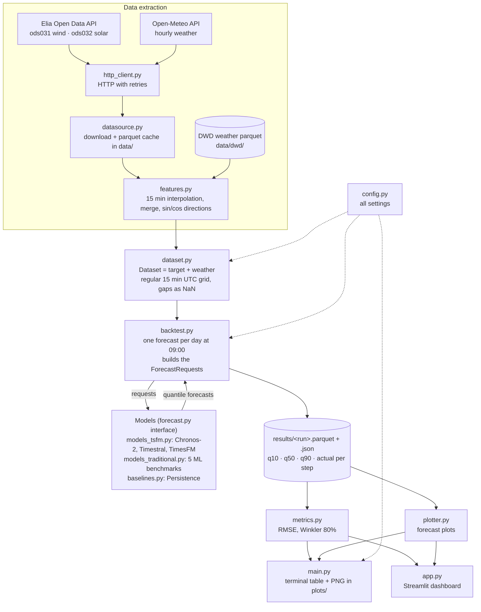
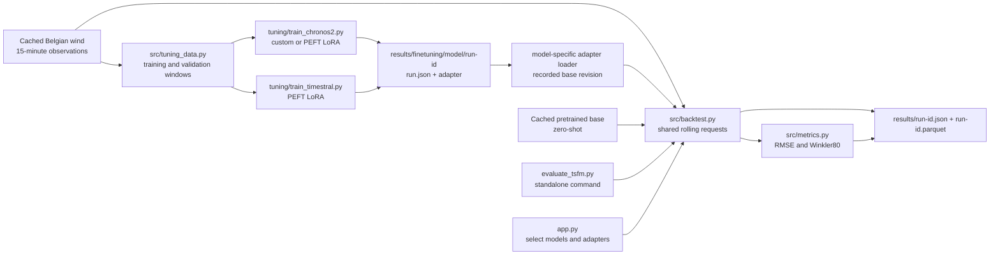

# ETHachi-TSFM

Benchmarking Time Series Foundation Models (TSFMs) for day-ahead renewable forecasting on the Belgian grid
(Hitachi Energy, Energy Now! 5.0 Challenge).

Every day at 09:00 UTC we forecast Elia's wind (or PV) generation in MW at 15 min resolution for the rest of the
day and the whole next day: 60 + 96 = **156 steps**. The pipeline replays this for every day of 2025
(rolling-window backtest) and scores each model with **RMSE** (point forecast, q50) and **Winkler score at 80%**
(interval q10–q90), the two metrics of the Predico forecasting market.

Models on this branch: **Chronos-2** (Amazon), **Timestral-209M** (Mistral), **TimesFM-3** (Google), five traditional
probabilistic benchmarks (**XGBoost, LightGBM, CatBoost, NGBoost, TabNet**), and a **persistence** baseline.
Traditional models can use either the `origin_aligned` or `fixed_gap` multi-horizon feature layout.
An earlier zero-shot implementation of **Moirai 1.1-R-Large** is available on the `origin/feature/moirai-1.1-r-large-zero-shot` branch; it has not been integrated into the current branch. See [Model support](#model-support).

## How the existing benchmark pipeline works

This diagram describes the shared rolling benchmark used by `main.py`, Streamlit and the TSFM evaluation command. Saved TSFM adapters can be selected alongside other models in Streamlit; only selected models and ensemble dependencies run. See [Independent TSFM tuning and evaluation](#independent-tsfm-tuning-and-evaluation).



1. **Data**: the extraction scripts download Elia generation and Open-Meteo weather (cached in `data/`) and merge
   them with the DWD weather file. `dataset.py` puts target and weather on one regular 15 min UTC grid.
2. **Backtest**: for each day of the test period, `backtest.py` cuts the data at the issue time (09:00 UTC minus
   the data latency) and builds one `ForecastRequest` per model: the last *context* steps of the target, the weather
   over the context and the forecast steps, and the 156 timestamps to forecast. Days with incomplete data are
   skipped for every model, so all models are scored on the same days.
3. **Models**: every model implements the same interface (`fit`, `predict`) and returns q10, q50 and q90 for each
   request. TSFMs and traditional models receive the same selected weather covariates. Traditional models also
   receive calendar features and target lags constructed without future-target leakage.
4. **Results**: all forecasts go into one long table in `results/`, one row per issue time × forecast step × model.
5. **Metrics and plots** are computed from that table, so they can be recomputed or redrawn without forecasting again.

## Quick start

### Setup
```bash
git clone <repo-url>
cd ETHachi-TSFM
uv sync                        # creates .venv from pyproject.toml / uv.lock
```
Without uv: install the packages listed in `pyproject.toml` with pip (`chronos-forecasting`, `timesfm`,
`timestral` from https://github.com/mistralai/timestral, `torch`, `pandas`, `pyarrow`, `matplotlib`, `plotly`,
`streamlit`, `requests`, `holidays`, `scikit-learn`, and the traditional-model packages). The merged environment
targets Python 3.14.

Activate the environment:
```bash
.venv\Scripts\activate         # Windows
source .venv/bin/activate      # Linux/macOS
```

The existing benchmark can download model weights from Hugging Face on first use. The independent TSFM trainers and evaluator use locally cached model revisions. The DWD file `data/dwd/gen_weather_dwd.parquet`
is in the repository; Elia and Open-Meteo data are downloaded on the first run and cached in `data/`.

### Run the backtest
```bash
python main.py            # run the backtest (about 11 min on CPU for the 3 TSFMs), print metrics, save a plot
python main.py --reuse    # reuse the saved results of the same settings: only metrics and plot (seconds)
```
Output: the metrics table in the terminal, the forecasts in `results/<run>.parquet` (+ `.json` with settings,
skipped days and timings) and a forecast plot in `plots/`.

### Context-length sweep
```bash
python context_sweep.py                            # CONTEXT_SWEEP_DAYS x CONTEXT_SWEEP_MODELS from config.py
python context_sweep.py --days 3 7 14 --reuse      # only the contexts/models not saved yet are run
python context_sweep.py --days 30 --device cuda    # one context per job, e.g. on a GPU cluster
python context_sweep.py --days 3 7 --every 7       # quick check: one forecast every 7 days
python context_sweep.py --days 3 7 14 --table-only # rebuild the table from the saved runs
```
Each context length is an ordinary backtest run (`results/wind_ctx<steps>_...parquet`, also visible in the dashboard).
Persistence runs once, with the shortest context, as reference. The table compares all runs on the issue days that
**every** run kept, so a longer context that skips more days because of data gaps is scored on the same days.
Output in `results/context_sweep/sweep_<contexts>.csv` (+ `.txt` with the printed report): per model and context
RMSE and Winkler 80% on all 156 steps and on D+1, RMSE vs persistence, q10–q90 coverage and inference seconds per
forecast; plus model × context pivots.

Long contexts are slow on a laptop CPU: [euler/README.md](euler/README.md) runs the sweep on the ETH Euler cluster,
one Slurm array task per context length, in parallel.

### Dashboard
```bash
python -m streamlit run app.py
```
Opens `http://localhost:8501`. Pick a saved run, the models and the evaluation window in the sidebar, then:
- **Model results overview**: scores from all saved evaluations in one table, with target, issue dates, context, horizon and covariates; filter by target and check settings before comparing runs.
- **Metrics**: score table, daily RMSE / Winkler over the year, CSV download, model timings
- **Forecasts over a period**: D+1 forecasts of consecutive days stitched over a chosen period
- **Single forecast**: all 156 steps of one issue time

The sidebar form **Run a new backtest** runs one with chosen models, context, horizon, latency, covariates and
traditional feature mode. Optuna is deliberately not run by the dashboard: it uses the defaults in `src/MLtrad.py`
plus optional `TRADITIONAL_MODEL_PARAMETERS` overrides. NGBoost and TabNet can still be slow on a full-year run.
Use `python -m streamlit` so it runs with the Python that has the models installed.

To compare a saved LoRA run with other models:

1. Choose `wind` as the target, then select the saved adapter and any zero-shot or other models under **Models and saved adapters**. Adapter labels show the run ID, training context, steps and rank.
2. Choose the first and last issue dates (both included), inference context, horizon and covariates. Choose no weather covariates to match the current wind-only training inputs.
3. Select **Run backtest**. The selected models are evaluated on the same valid origins; this does not retrain the adapter.
4. Open **Training and evaluation history** to inspect training-run details, see which runs have a recorded rolling backtest, and compare saved scores. Select a saved backtest in the sidebar to view its metrics and forecasts.

Each dashboard backtest creates a separate result record. Training remains a separate command and does not automatically launch a backtest. Use validation dates for repeated model selection, and reserve the 2025 holdout for a final comparison.

## Configuration (`config.py`)

| Setting | Default | Meaning |
|---|---|---|
| `TARGET_SOURCE` | `"wind"` | target series (`"wind"` or `"solar"`), sum over the Elia regions |
| `BACKTEST_MODELS` | persistence + XGBoost + 3 TSFMs | keys of `MODELS_REGISTRY` to run |
| `BACKTEST_ISSUE_TIME` | `"09:00"` | daily issue time, UTC |
| `BACKTEST_HORIZON_STEPS` | `156` | steps forecast from the issue time |
| `BACKTEST_CONTEXT_DAYS` | `3` | target history given to the models, in days; `BACKTEST_CONTEXT_STEPS` (15 min steps) is derived from it |
| `BACKTEST_ISSUE_EVERY_DAYS` | `1` | one forecast every N days of the test period (N > 1 for quick runs; the run name gets `_everyNd`) |
| `CONTEXT_SWEEP_DAYS` / `CONTEXT_SWEEP_MODELS` | `[3, 7]` / 3 TSFMs | context lengths and models of `context_sweep.py` |
| `BACKTEST_LATENCY_STEPS` | `0` | steps between the last available measurement and the issue time |
| `TSFM_COVARIATES` | DWD wind variables | weather columns given to the TSFMs, per target |
| `TRADITIONAL_STRATEGY` | `"fixed_gap"` | `origin_aligned` or `fixed_gap` for traditional ML |
| `TRADITIONAL_MODEL_PARAMETERS` | empty overrides | manual/saved parameters merged over the preserved model defaults |
| `TEST_START` / `TEST_END` | 2025 | issue days of the backtest |
| `TRAIN_START` / `TRAIN_END` | 2024 | training period passed to `fit` (unused by zero-shot models) |
| `BACKTEST_EVAL_WINDOW` | `"all"` | metrics on all 156 steps, or `"d+1"`: only the next day 00:00–23:45 (as Predico) |
| `BACKTEST_PLOT_START` / `_END` / `_MODELS` | 1–14 Mar 2025, all | period and models of the forecast plot |
| `OPENMETEO_SOURCES["weather"]["dwd"]["use"]` | `True` | merge the DWD weather file (needed for the wind covariates) |

`src/validate_config.py` checks these at start-up and lists every invalid setting.

The legacy `main.py` run name reflects settings, e.g. `wind_ctx288_h156_lat0_cov7-43744b` = context 288, horizon 156, latency 0, 7 covariates (+ short hash of their names). With that legacy save path, re-running one model with the same name replaces only its rows. Dashboard and standalone TSFM backtests instead use unique filenames to preserve each evaluation.

## Scripts

| File | What it does |
|---|---|
| `main.py` | Entry point: validate config → load dataset → backtest → save → print metrics → save plot. `--reuse` skips the backtest if the run exists. |
| `context_sweep.py` | Context-length sweep of the TSFMs on the shared backtest (logic in `src/context_sweep.py`); one comparison table. |
| `app.py` | Streamlit dashboard on the saved runs, plus a form to run new backtests. |
| `config.py` | All settings: models, target, covariates, backtest, train/test periods, data sources, logging. |
| `logger.py` | Project logger (console, optional file via `LOG_FILE`). |
| **Data extraction** | |
| `src/http_client.py` | `requests` session bound to one API, with retries on 429/5xx and readable errors. |
| `src/datasource.py` | Downloads Elia generation (per region, 15 min) and Open-Meteo weather (hourly); parquet cache in `data/`. |
| `src/features.py` | 15 min interpolation, merge of the weather sources and the DWD file, sin/cos encoding of directions; lag and calendar features for tabular models. |
| **Forecasting pipeline** | |
| `src/dataset.py` | Adapter between extraction and forecasting: `load_dataset()` returns target and weather on a regular 15 min UTC grid. A new extraction strategy only needs changes here. |
| `src/forecast.py` | Shared types: `ForecastRequest` (validated inputs of one forecast), `ForecastResult` (q10/q50/q90), `Forecaster` (interface of every model). |
| `src/models_tsfm.py` | Inference adapters for Chronos-2, Timestral-209M and TimesFM-3: load weights once, batch requests, pass supported covariates, time inference. Fine-tuning is performed by the standalone trainers. |
| `tuning/train_chronos2.py`, `tuning/train_timestral.py` | Independent wind-only LoRA training and adapter reload checks. |
| `tuning/train_moirai.py`, `tuning/train_timesfm.py` | Placeholders for future training implementations. |
| `src/tuning_data.py` | Shared wind-only training and validation windows for the LoRA trainers. |
| `src/tsfm_runs.py` | Local run manifests, atomic JSON writes and artifact fingerprints. |
| `evaluate_tsfm.py` | Standalone wind-only command using the shared rolling backtest for one zero-shot TSFM, optionally paired with its LoRA adapter. |
| `src/models_traditional.py` | Shared-backtest adapter for XGBoost, LightGBM, CatBoost, NGBoost and TabNet; builds either feature mode and returns q10/q50/q90. |
| `src/MLtrad.py` | Traditional estimators, preserved parameter defaults, quantile prediction, probabilistic scoring, time-based cross-validation and offline Optuna tuning. |
| `src/baselines.py` | Persistence: repeats the last 156 observed values (q50 only). |
| `src/backtest.py` | Rolling-window engine: issue times, requests, skipped days, `fit` + `predict`, results table; `save_backtest` / `load_backtest` / `saved_runs`. |
| `src/metrics.py` | RMSE and Winkler 80% per forecast, averaged over the days (Predico); evaluation window `all` or `d+1`; terminal table. |
| `src/plotter.py` | `plot_backtest` (PNG for `main.py`) and interactive Plotly charts for the dashboard; one fixed color per model. |
| `src/validate_config.py` | Sanity checks of `config.py`. |
| **Traditional-model utilities** | |
| `src/models.py` | Time-based train/test split and cross-validation, XGBoost regressor. |

### Adding a model
Write a class implementing `Forecaster` (`src/forecast.py`): set `name`, `min_context`, `uses_covariates`, and implement `predict(requests) -> results`. For a TSFM, add its checkpoint to `MODELS_REGISTRY` and its inference adapter to `TSFM_ADAPTERS` in `src/models_tsfm.py`. The existing benchmark can then load it by key. The independent evaluator also needs a compatible cached snapshot and model loader; adapter evaluation additionally requires explicit model-specific loading support. Add a standalone trainer separately if fine-tuning is implemented. Do not add a model to `BACKTEST_MODELS` unless it should run in the default benchmark.

## Data sources

- **Elia Open Data** (https://opendata.elia.be): measured generation in MW, 15 min, UTC.
  `ods031` wind (regions Flanders, Wallonia, Federal = offshore), `ods032` solar (Belgium).
- **DWD weather** (`data/dwd/gen_weather_dwd.parquet`, 15 min, 2024-01 – 2026-01): mean and std of temperature,
  humidity, pressure, wind speed at 10/80/120/180 m, wind direction, gusts. Its `measured` column equals Elia's
  Federal (offshore) wind, so the grid points are the offshore parks.
- **Open-Meteo** historical forecast API (https://open-meteo.com): hourly cloud cover and radiation at one point
  in Belgium, for the solar covariates.
- **Wind power coordinates** taken from List of power stations in Belgium (https://en.wikipedia.org/wiki/List_of_power_stations_in_Belgium) and List of offshore wind farms in Belgium (https://en.wikipedia.org/wiki/List_of_offshore_wind_farms_in_Belgium). Use only coordinates with production above 5 MW to rule out small onshore wind power.

## Known limitations and next steps

- **Weather is "most recent forecast"**, not the forecast available at 09:00 of the day before (Open-Meteo
  historical forecast API, DWD file), so covariate results are optimistic. Next: Open-Meteo Previous Runs API.
- **Target vs covariates**: the wind target sums onshore and offshore, while the DWD covariates describe the offshore
  parks. Predico and the Hitachi report forecast offshore (Federal) only.
- **Negative forecasts**: Chronos-2 and TimesFM-3 can forecast below 0 MW; no clipping is applied yet.
- **D+1 is in UTC days**; Predico probably uses Brussels local days (to be checked).
- **Data ends 2025-12-31 23:30**, so the forecasts of 30 and 31 December 2025 are skipped.
- **Next**: validate the traditional benchmarks over the full common test period, persist selected Optuna parameters,
  run context-length sweeps and study covariate importance.

# Independent TSFM tuning and evaluation

## Architecture and data flow

Training and evaluation are separate jobs. A trainer selects one model, creates a LoRA adapter and saves a run record. The evaluator later loads a base checkpoint and, optionally, that adapter; it does not retrain during the rolling backtest. Training code and losses remain specific to each model.



| Component | Current responsibility |
|---|---|
| `config.py` | Registry of models and checkpoints, wind source, resolution, issue time, default horizon and data bounds. |
| `src/tuning_data.py` | Loads the aggregate wind target and builds training and December validation windows shared by both trainers. |
| `tuning/train_chronos2.py` | Trains one Chronos-2 adapter using the custom or PEFT backend; evaluates zero-shot and tuned checkpoints and verifies adapter reload. |
| `tuning/train_timestral.py` | Trains one Timestral-209M PEFT adapter using its normalized quantile loss and advancing frames; supports attention-only or attention-plus-MLP targets and its configurable optimizer schedule. |
| `src/tsfm_runs.py` | Creates local run records, fingerprints data, captures selected package and Git information, and atomically updates JSON manifests. |
| `src/models_tsfm.py` and `src/forecast.py` | Model-specific inference adapters and the shared request/result interface. Each TSFM library is imported when its model is loaded. |
| `src/backtest.py` | Shared rolling evaluation: loads selected models, builds requests for common valid origins, collects forecasts and scores them. A saved adapter is a selectable model variant. |
| `evaluate_tsfm.py` | Standalone wind-only command that calls the shared backtest with one zero-shot TSFM and optionally its saved adapter. |
| `src/metrics.py` | Scores q50 RMSE and q10–q90 Winkler80 in MW; the reported score is the mean of the per-origin scores. |

The current standalone trainers use `wind_MW`, aggregated across Belgian regions, with no covariates. Training windows lie in January–November 2024; December 2024 daily origins at 09:00 UTC are used for validation and checkpoint selection. The default context is 288 steps (three days) and the horizon is 156 steps (39 hours). The proposed final holdout is 2025 after model and settings are fixed. Evaluation is rolling: later 2025 origins may use earlier observed 2025 values as history, while adapter weights remain fixed.

The shared backtest builds a contiguous history for each origin. Zero-shot and adapter variants of the same model receive matching requests and use the adapter's recorded base revision. It records and skips origins without complete history or labels. The inference context length is independent of the context used during adapter training. The dashboard can pass its selected weather covariates during inference; the existing LoRA trainers are wind-only, and the standalone `evaluate_tsfm.py` command uses no covariates. Retrieval or RAFT-style context policies and training with covariates are not yet implemented; a non-contiguous context will need a suitable request contract.

### Model support

| Model | Zero-shot evaluation | LoRA training and paired evaluation |
|---|---|---|
| Chronos-2 (`amazon/chronos-2`) | Implemented | Implemented; custom and PEFT adapters |
| Timestral-209M (`mistralai/Timestral-209M`) | Implemented | Implemented; PEFT adapters |
| TimesFM-3 (`google/timesfm-3.0-pytorch`) | Implemented | Training placeholder only |
| Moirai 1.1-R-Large (`Salesforce/moirai-1.1-R-large`) | Implemented on `origin/feature/moirai-1.1-r-large-zero-shot`; not integrated into this branch or `evaluate_tsfm.py` | Training placeholder only |

Training losses are model-specific and are not directly comparable across Chronos and Timestral. Compare forecasts on matching origins using metrics in MW. December results used to choose a checkpoint are validation results, not independent holdout evidence.

**Moirai implementation on the feature branch.** Commit `8c865ae` includes `src/moirai_process.py`, `src/moirai_worker.py`, `requirements-moirai.txt`, and corresponding changes to the earlier model runner, registry and Streamlit app. The process bridge passes a target context to a separate Python worker; the worker uses Uni2TS and GluonTS to load `Salesforce/moirai-1.1-R-large` and produce q10, q50 and q90 forecasts. The branch documents a separate `.venv-moirai` (for example Python 3.11), a compatible PyTorch installation, its `requirements-moirai.txt`, and `MOIRAI_PYTHON` pointing to that environment's interpreter. The model checkpoint must also be available to the worker.

Those files and the Moirai registry entry are absent from the current `Chronos-finetuning` branch, and the feature branch uses an older model-runner interface. Bringing the implementation here therefore requires integrating and checking the bridge, worker, dependencies and model interface; simply running the current `evaluate_tsfm.py --model moirai` will not work. The feature-branch code has been inspected but was not executed as part of this documentation update. The `tuning/train_moirai.py` in this branch remains a training placeholder.

### Artifacts and run identity

```text
results/
  finetuning/<model>/<run-id>/
    run.json                 # training configuration, status and scores
    finetuned-ckpt/          # PEFT adapter, when using PEFT
    adapter.safetensors      # alternative custom Chronos adapter
  <evaluation-id>.json       # settings, model/training records, scores and skipped origins
  <evaluation-id>.parquet    # issue time, timestamp, model, quantiles, actual
  backtest_attempts/         # status and parameters, including failed or interrupted attempts
  tsfm_evaluations/          # earlier standalone TSFM results, retained for reference
```

Each new training manifest records its base checkpoint and revision, adapter path, input parameters, dataset path and SHA-256 fingerprint, context, horizon, split, validation origins, scores, selected package versions and Git commit/dirty state. Status is `running`, `completed`, or `failed`; completion follows the adapter reload check. JSON updates are atomic. Existing verified run manifests and the custom Chronos adapter remain readable, although older records can lack newer provenance fields. An interrupted run can remain `running`.

Each new dashboard or standalone TSFM evaluation gets a unique filename so repeated runs remain separate. Its JSON records settings, selected-model metadata, adapter fingerprints and training record, data fingerprint, skipped origins, timings and scores. Valid origins are available in the predictions table. A separate attempt record stores its settings and status, including failures; a process stopped unexpectedly may remain marked `running`. Input validation before the attempt starts is not recorded. The original `main.py` save/reuse behavior remains unchanged. `results/` is Git-ignored; share or back it up separately when needed.

In Streamlit, select a target, models and/or saved LoRA runs, inference settings and issue dates, then start one backtest. The training and evaluation history shows saved settings and scores, including earlier standalone evaluations; new results can also be opened in the existing metrics and forecast views. Training is still started independently, and training runs without a recorded backtest are flagged in the history. The standalone TSFM command reads cached wind directly; neither entry point runs traditional models unless they are selected or needed by a selected ensemble.

## Quick terminal tests

Run these PowerShell commands from the repository root. Each evaluation tests one model on one December 2024 origin using cached wind data, a 288-step context and a 156-step horizon. This short validation-period check verifies the workflow; it is not an independent measure of model performance. The relevant model checkpoint must already be in the Hugging Face cache.

```powershell
# Chronos-2, zero-shot
.\.venv\Scripts\python.exe evaluate_tsfm.py --model chronos2 --start 2024-12-10T00:00:00Z --end 2024-12-11T00:00:00Z --device cpu

# Timestral-209M, zero-shot
.\.venv\Scripts\python.exe evaluate_tsfm.py --model timestral_209m --start 2024-12-10T00:00:00Z --end 2024-12-11T00:00:00Z --device cpu

# TimesFM-3, zero-shot
.\.venv\Scripts\python.exe evaluate_tsfm.py --model timesfm3 --start 2024-12-10T00:00:00Z --end 2024-12-11T00:00:00Z --device cpu
```

For a short training and adapter-reload test, run either trainer independently. The timestamp gives each run a new ID; use another ID if the directory already exists.

```powershell
# Chronos-2 PEFT: three optimizer steps
$runId = "chronos-smoke-" + (Get-Date -Format "yyyyMMdd-HHmmss")
.\.venv\Scripts\python.exe -m tuning.train_chronos2 --backend peft --run-id $runId --steps 3 --batch-size 1 --device cpu
.\.venv\Scripts\python.exe evaluate_tsfm.py --model chronos2 --adapter-run-id $runId --start 2024-12-10T00:00:00Z --end 2024-12-11T00:00:00Z --device cpu

# Timestral-209M PEFT: three optimizer steps
$runId = "timestral-smoke-" + (Get-Date -Format "yyyyMMdd-HHmmss")
.\.venv\Scripts\python.exe -m tuning.train_timestral --run-id $runId --steps 3 --batch-size 1 --device cpu
.\.venv\Scripts\python.exe evaluate_tsfm.py --model timestral_209m --adapter-run-id $runId --start 2024-12-10T00:00:00Z --end 2024-12-11T00:00:00Z --device cpu
```

The adapter commands compare zero-shot and the newly trained adapter on the same origin. `tuning/train_moirai.py` and `tuning/train_timesfm.py` are placeholders. Moirai zero-shot code exists on the feature branch described above but is not available in this branch's evaluator; Moirai and TimesFM training are not implemented here.

## Full training and evaluation

The standalone trainers use cached Belgian wind generation, without covariates. They never train XGBoost. Use a new ID for each training run:

```powershell
.\.venv\Scripts\python.exe -m tuning.train_chronos2 --backend peft --run-id chronos-example --steps 200 --device cpu
.\.venv\Scripts\python.exe -m tuning.train_timestral --run-id timestral-example --steps 200 --device cpu
```

New runs under `results/finetuning/<model>/<run-id>/` record arguments, data fingerprint, base revision, split, scores, adapter path and reload verification. `run.json` has a status; only a completed run with a reload check can be evaluated. Existing verified run records and both Chronos adapter formats remain supported. A run interrupted before completion may remain `running` and must not be reused.

Evaluate one model, or compare its base and adapter on the same origins:

```powershell
.\.venv\Scripts\python.exe evaluate_tsfm.py --model chronos2 --adapter-run-id chronos-example --start 2025-01-01T00:00:00Z --end 2026-01-01T00:00:00Z
.\.venv\Scripts\python.exe evaluate_tsfm.py --model timestral_209m --adapter-run-id timestral-example --context-steps 672
.\.venv\Scripts\python.exe evaluate_tsfm.py --model timesfm3
```

Dates bound issue times with an exclusive end. The default is 09:00 UTC, zero latency, a 156-step horizon and 288 contiguous history steps. Inference context is independent of training. For adapter comparisons the exact base revision must already be cached. The command saves a unique JSON/Parquet pair directly under `results/` and does not reuse old results. Origins with incomplete history or labels are skipped, including the end of 2025 if the dataset has no later labels. This command is wind-only.
## Experiment tracking with MLflow

Training and rolling backtest results can be recorded locally in `results/mlflow.db` and `results/mlflow_artifacts/`. These files are ignored by Git; back them up alongside `results/`.

After installing the project dependencies with `uv sync`, import existing records once:

```powershell
.\.venv\Scripts\python.exe import_experiments.py
.\.venv\Scripts\python.exe -m mlflow ui --backend-store-uri sqlite:///results/mlflow.db --port 5000
```

Open http://localhost:5000 and select the `ETHachi forecasting` experiment. New completed training records and recorded backtests are logged automatically. If tracking fails, the original local run remains saved and a warning is written to the log; rerun the importer to retry. Each rolling model evaluation logs mean per-origin RMSE and Winkler80 over all forecast steps, plus its parameters and prediction artifact. Older records retain their original provenance and may have missing values.

In Streamlit, choose a saved evaluation and open **Compare across compatible runs**. Select compatible evaluations containing the models and an XGBoost baseline. The comparison requires the same data fingerprint, settings, issue/timestamp grid, and ELIA actual values; old results without a data fingerprint can only be inspected within their own evaluation. ELIA and the chosen XGBoost baseline appear in the forecast plot. A missing baseline requires a matching new evaluation. This comparison does not train adapters or automatically schedule missing evaluations.
In Streamlit, expand **Train a new LoRA adapter** to start an existing PEFT trainer in the background. The form records the run name, model, context, steps, batch size, rank, learning rate, seed and device; the adapter and a training log are saved locally. Refresh the dashboard to check status. These trainers currently use wind without weather covariates; evaluation covariates are selected separately. After training, evaluate the adapter using **Run a new backtest** before adding it to a benchmark comparison.
