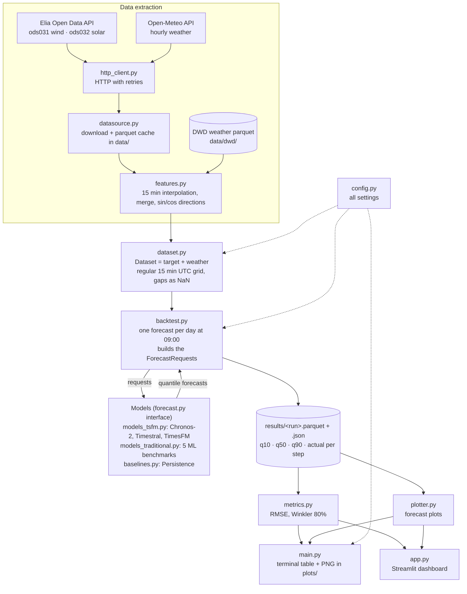

# ETHachi-TSFM

Benchmarking Time Series Foundation Models (TSFMs) for day-ahead renewable forecasting on the Belgian grid
(Hitachi Energy, Energy Now! 5.0 Challenge).

Every day at 09:00 UTC we forecast Elia's wind (or PV) generation in MW at 15 min resolution for the rest of the
day and the whole next day: 60 + 96 = **156 steps**. The pipeline replays this for every day of 2025
(rolling-window backtest) and scores each model with **RMSE** (point forecast, q50) and **Winkler score at 80%**
(interval q10–q90), the two metrics of the Predico forecasting market.

Models so far: **Chronos-2** (Amazon), **Timestral-209M** (Mistral), **TimesFM-3** (Google), five traditional
probabilistic benchmarks (**XGBoost, LightGBM, CatBoost, NGBoost, TabNet**), and a **persistence** baseline.
Traditional models can use either the `origin_aligned` or `fixed_gap` multi-horizon feature layout.

## How the pipeline works



1. **Data**: the extraction scripts download Elia generation and Open-Meteo weather (cached in `data/`) and merge
   them with the DWD weather file. `dataset.py` puts target and weather on one regular 15 min UTC grid.
2. **Backtest**: for each day of the test period, `backtest.py` cuts the data at the issue time (09:00 UTC minus
   the data latency) and builds one `ForecastRequest` per model: the last *context* steps of the target, the weather
   over the context and the forecast steps, and the 156 timestamps to forecast. Days with incomplete data are
   skipped for every model, so all models are scored on the same days.
3. **Models**: every model implements the same interface (`fit`, `predict`) and returns q10, q50 and q90 for each
   request. TSFMs and traditional models receive the same selected weather covariates. Traditional models also
   receive calendar features and target lags constructed without future-target leakage.
4. **Results**: all forecasts go into one long table in `results/`, one row per issue time × forecast step × model.
5. **Metrics and plots** are computed from that table, so they can be recomputed or redrawn without forecasting again.

## Quick start

### Setup
```bash
git clone <repo-url>
cd ETHachi-TSFM
uv sync                        # creates .venv from pyproject.toml / uv.lock
```
Without uv: install the packages listed in `pyproject.toml` with pip (`chronos-forecasting`, `timesfm`,
`timestral` from https://github.com/mistralai/timestral, `torch`, `pandas`, `pyarrow`, `matplotlib`, `plotly`,
`streamlit`, `requests`, `holidays`, `scikit-learn`, and the traditional-model packages). The merged environment
targets Python 3.14.

Activate the environment:
```bash
.venv\Scripts\activate         # Windows
source .venv/bin/activate      # Linux/macOS
```

The model weights are downloaded from Hugging Face on first use. The DWD file `data/dwd/gen_weather_dwd.parquet`
is in the repository; Elia and Open-Meteo data are downloaded on the first run and cached in `data/`.

### Run the backtest
```bash
python main.py            # run the backtest (about 11 min on CPU for the 3 TSFMs), print metrics, save a plot
python main.py --reuse    # reuse the saved results of the same settings: only metrics and plot (seconds)
```
Output: the metrics table in the terminal, the forecasts in `results/<run>.parquet` (+ `.json` with settings,
skipped days and timings) and a forecast plot in `plots/`.

### Dashboard
```bash
python -m streamlit run app.py
```
Opens `http://localhost:8501`. Pick a saved run, the models and the evaluation window in the sidebar, then:
- **Metrics**: score table, daily RMSE / Winkler over the year, CSV download, model timings
- **Forecasts over a period**: D+1 forecasts of consecutive days stitched over a chosen period
- **Single forecast**: all 156 steps of one issue time

The sidebar form **Run a new backtest** runs one with chosen models, context, horizon, latency, covariates and
traditional feature mode. Optuna is deliberately not run by the dashboard: it uses the defaults in `src/MLtrad.py`
plus optional `TRADITIONAL_MODEL_PARAMETERS` overrides. NGBoost and TabNet can still be slow on a full-year run.
Use `python -m streamlit` so it runs with the Python that has the models installed.

## Configuration (`config.py`)

| Setting | Default | Meaning |
|---|---|---|
| `TARGET_SOURCE` | `"wind"` | target series (`"wind"` or `"solar"`), sum over the Elia regions |
| `BACKTEST_MODELS` | persistence + XGBoost + 3 TSFMs | keys of `MODELS_REGISTRY` to run |
| `BACKTEST_ISSUE_TIME` | `"09:00"` | daily issue time, UTC |
| `BACKTEST_HORIZON_STEPS` | `156` | steps forecast from the issue time |
| `BACKTEST_CONTEXT_STEPS` | `3 * 96` | target history given to the models (15 min steps) |
| `BACKTEST_LATENCY_STEPS` | `0` | steps between the last available measurement and the issue time |
| `TSFM_COVARIATES` | DWD wind variables | weather columns given to the TSFMs, per target |
| `TRADITIONAL_STRATEGY` | `"origin_aligned"` | `origin_aligned` or `fixed_gap` for traditional ML |
| `TRADITIONAL_MODEL_PARAMETERS` | empty overrides | manual/saved parameters merged over the preserved model defaults |
| `TEST_START` / `TEST_END` | 2025 | issue days of the backtest |
| `TRAIN_START` / `TRAIN_END` | 2024 | training period passed to `fit` (unused by zero-shot models) |
| `BACKTEST_EVAL_WINDOW` | `"all"` | metrics on all 156 steps, or `"d+1"`: only the next day 00:00–23:45 (as Predico) |
| `BACKTEST_PLOT_START` / `_END` / `_MODELS` | 1–14 Mar 2025, all | period and models of the forecast plot |
| `DATA_USE_DWD` | `True` | merge the DWD weather file (needed for the wind covariates) |

`src/validate_config.py` checks these at start-up and lists every invalid setting.

A run is named after its settings, e.g. `wind_ctx288_h156_lat0_cov7-43744b` = context 288, horizon 156, latency 0,
7 covariates (+ short hash of their names). Re-running one model with the same settings replaces only its rows.

## Scripts

| File | What it does |
|---|---|
| `main.py` | Entry point: validate config → load dataset → backtest → save → print metrics → save plot. `--reuse` skips the backtest if the run exists. |
| `app.py` | Streamlit dashboard on the saved runs, plus a form to run new backtests. |
| `config.py` | All settings: models, target, covariates, backtest, train/test periods, data sources, logging. |
| `logger.py` | Project logger (console, optional file via `LOG_FILE`). |
| **Data extraction** | |
| `src/http_client.py` | `requests` session bound to one API, with retries on 429/5xx and readable errors. |
| `src/datasource.py` | Downloads Elia generation (per region, 15 min) and Open-Meteo weather (hourly); parquet cache in `data/`. |
| `src/features.py` | 15 min interpolation, merge of the weather sources and the DWD file, sin/cos encoding of directions; lag and calendar features for tabular models. |
| **Forecasting pipeline** | |
| `src/dataset.py` | Adapter between extraction and forecasting: `load_dataset()` returns target and weather on a regular 15 min UTC grid. A new extraction strategy only needs changes here. |
| `src/forecast.py` | Shared types: `ForecastRequest` (validated inputs of one forecast), `ForecastResult` (q10/q50/q90), `Forecaster` (interface of every model). |
| `src/models_tsfm.py` | Adapters for Chronos-2, Timestral-209M and TimesFM-3: load weights once, batch requests, pass weather covariates, time inference. `fit` is where fine-tuning will go. |
| `src/models_traditional.py` | Shared-backtest adapter for XGBoost, LightGBM, CatBoost, NGBoost and TabNet; builds either feature mode and returns q10/q50/q90. |
| `src/MLtrad.py` | Traditional estimators, preserved parameter defaults, quantile prediction, probabilistic scoring, time-based cross-validation and offline Optuna tuning. |
| `src/baselines.py` | Persistence: repeats the last 156 observed values (q50 only). |
| `src/backtest.py` | Rolling-window engine: issue times, requests, skipped days, `fit` + `predict`, results table; `save_backtest` / `load_backtest` / `saved_runs`. |
| `src/metrics.py` | RMSE and Winkler 80% per forecast, averaged over the days (Predico); evaluation window `all` or `d+1`; terminal table. |
| `src/plotter.py` | `plot_backtest` (PNG for `main.py`) and interactive Plotly charts for the dashboard; one fixed color per model. |
| `src/validate_config.py` | Sanity checks of `config.py`. |
| **Traditional-model utilities** | |
| `src/models.py` | Time-based train/test split and cross-validation, XGBoost regressor. |

### Adding a model
Write a class implementing `Forecaster` (`src/forecast.py`): set `name`, `min_context`, `uses_covariates`,
implement `predict(requests) -> results` (and `fit` if it trains), register it in `MODELS_REGISTRY` and in
`load_forecaster` (`src/backtest.py`), then add its key to `BACKTEST_MODELS`. The backtest, metrics, plots and
dashboard pick it up without changes.

## Data sources

- **Elia Open Data** (https://opendata.elia.be): measured generation in MW, 15 min, UTC.
  `ods031` wind (regions Flanders, Wallonia, Federal = offshore), `ods032` solar (Belgium).
- **DWD weather** (`data/dwd/gen_weather_dwd.parquet`, 15 min, 2024-01 – 2026-01): mean and std of temperature,
  humidity, pressure, wind speed at 10/80/120/180 m, wind direction, gusts. Its `measured` column equals Elia's
  Federal (offshore) wind, so the grid points are the offshore parks.
- **Open-Meteo** historical forecast API (https://open-meteo.com): hourly cloud cover and radiation at one point
  in Belgium, for the solar covariates.
- **Wind power coordinates** taken from List of power stations in Belgium (https://en.wikipedia.org/wiki/List_of_power_stations_in_Belgium) and List of offshore wind farms in Belgium (https://en.wikipedia.org/wiki/List_of_offshore_wind_farms_in_Belgium). Use only coordinates with production above 5 MW to rule out small onshore wind power.

## Known limitations and next steps

- **Weather is "most recent forecast"**, not the forecast available at 09:00 of the day before (Open-Meteo
  historical forecast API, DWD file), so covariate results are optimistic. Next: Open-Meteo Previous Runs API.
- **Target vs covariates**: the wind target sums onshore and offshore, while the DWD covariates describe the offshore
  parks. Predico and the Hitachi report forecast offshore (Federal) only.
- **Negative forecasts**: Chronos-2 and TimesFM-3 can forecast below 0 MW; no clipping is applied yet.
- **D+1 is in UTC days**; Predico probably uses Brussels local days (to be checked).
- **Data ends 2025-12-31 23:30**, so the forecasts of 30 and 31 December 2025 are skipped.
- **Next**: validate the traditional benchmarks over the full common test period, persist selected Optuna parameters,
  fine-tune the TSFMs in `fit`, run context-length sweeps, and study covariate importance.
